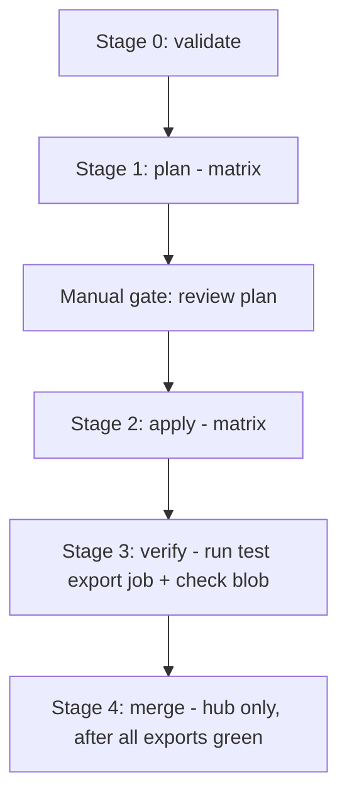

# CI/CD planning — GitLab repo and pipeline for fleet-wide rollout

Planning notes for the automation engineering team meeting (2026-10-30) on building a
GitLab repo and pipeline to deploy the cost-analysis-export solution to the remaining
clusters, using the customer's existing GitLab tooling (hosted on
`aks-kites-dev-usgovva-gitlab` / `aks-kites-dev-usgovva-gitlab-runners-000`).

This captures the plan discussed before the meeting, so it can be reviewed, revised, and
tracked against as the pipeline is built. Nothing described here has been built yet —
this is a planning document, not a deployment record.

## Why Terraform CI/CD and not something new

The Terraform scaffold under [`terraform/`](../terraform/) was already designed for
exactly this: a CI matrix over a cluster-list JSON, one Terraform state per cluster. See
[05-terraform-modules.md](05-terraform-modules.md) and
[06-terraform-deployment-guide.md](06-terraform-deployment-guide.md) for the existing
module design and manual-run instructions. The pipeline work is to automate those same
steps in GitLab CI, not to invent a new deployment mechanism.

## 1. Cluster classification (don't treat the fleet as one batch)

Source: [14-aks-cluster-inventory.md](14-aks-cluster-inventory.md) (queried 2026-10-16).
The working list provided to automation engineering contains the known
`hub-mgmt-test-aks` duplicate; after dedup this is the same **53 unique clusters**
tracked in the inventory doc.

| Bucket | Count | Clusters | What's needed |
|---|---|---|---|
| **Implemented** | 12 | Atlas ×10, `aks-kites-dev-usgovva-staging`, `aks-paas-dev-usgovva-kites` | Nothing — exclude from the apply pipeline, or include only as a drift-detection `plan`-only job |
| **Prepared only** | 13 | Data Services ×5, IL5/IL4 team ×8 | Azure identity (UAMI, storage role, federated credential) already done; needs the Terraform/`kubectl` apply against the cluster |
| **Prepared only — blocked** | 2 | `aks-il5-team-dev-ugva-development` (Azure Kubernetes RBAC `Forbidden`), `aks-il5-team-il4dev-ugva-development` (private DNS resolution failure) | Exclude from automation until the underlying infra issue is resolved by the customer; do not let the pipeline retry-loop into these |
| **Not implemented** | 26 | AMS, IRIS ×3, Kites non-staging ×9, MITLL, PaaS non-kites ×7, Pitt ×2, Quake, VPNG, `hub-mgmt-test-aks` | Full flow: confirm OIDC/Workload Identity/Cost Analysis tier prerequisites first (several show `Disabled`/`Failed` in the inventory and must be fixed by the cluster owner before any pipeline run), then Azure identity + manifest + deploy |

**Do not** let the pipeline attempt "Not implemented" clusters that currently show OIDC
or Workload Identity as `Disabled` — it will just fail partway through. Add a pre-flight
gate (Stage 0 below) that checks those AKS properties via the REST API and fails fast
with a clear message instead of a confusing Terraform error. (The installed Azure CLI
version does not reliably expose `metricsProfile.costAnalysis.enabled`; query the AKS
REST API directly, `api-version=2024-09-01`, as already done for the inventory doc.)

## 2. Biggest risk: private cluster network reachability, not pipeline tooling

Two clusters have already failed manual deployment for this exact reason:
- `aks-il5-team-dev-ugva-development` — Azure Kubernetes RBAC denied the apply.
- `aks-il5-team-il4dev-ugva-development` — kube VDI couldn't resolve the private AKS
  API server's DNS name.

A GitLab-hosted pipeline has the **same constraint**: the Terraform `kubernetes`
provider (used by `terraform/modules/workload`) needs a real network path to each
target cluster's private API server, exactly like `kubectl` did from the kube VDI.

Open questions to resolve with the network/infra team before committing to a rollout
timeline:
- Do the GitLab runners sit in a VNet that's peered/routable to every target cluster's
  private API server? This must be verified **per subscription / per VNet**, not assumed
  fleet-wide — the IL5/IL4 clusters are in distinct subscriptions from the GitLab host
  and may have different network topology.
- If not routable, options are: self-hosted runners placed per network zone, or a
  routing/DNS forwarding fix at the network layer (the same class of fix the IL4 DNS
  blocker already needs).

**Recommendation**: before building the full pipeline, run one real `terraform plan`
(read-only, no apply) from a GitLab CI job against one already-"Prepared only" cluster
per network zone/subscription, to prove connectivity before discovering 26 individual
failures mid-rollout.

## 3. Proposed pipeline architecture

- **Stage 0 — validate**: per cluster, confirm AKS tier (Standard/Premium), OIDC issuer
  enabled, Workload Identity enabled, Cost Analysis add-on enabled (via REST API, not
  CLI), before any Terraform runs.
- **Stage 1 — plan (matrix)**: `terraform plan` per cluster, matrix job, no changes
  applied yet.
- **Manual gate**: required before apply, not optional — several clusters have
  `disableLocalAccounts: true` plus Azure RBAC, so a misconfigured apply is hard to
  recover from without an authorized cluster administrator.
- **Stage 2 — apply (matrix)**: `terraform apply` per cluster.
- **Stage 3 — verify**: run a one-off export `Job` from the deployed `CronJob` and
  confirm `data processing completed successfully` plus the expected blob path, reusing
  the logic in [scripts/validate-exports.ps1](../scripts/validate-exports.ps1) and
  [scripts/check-result.ps1](../scripts/check-result.ps1).
- **Stage 4 — merge**: hub-only, run once after all per-cluster exports in a batch are
  verified green.

### Source of truth for the cluster list

Expand [terraform/clusters.example.json](../terraform/clusters.example.json) into a real
`terraform/clusters.json` listing every cluster to automate
(`cluster_name`, `subscription_id`, `resource_group`, `identity_shard_index`). Generate
it once from the inventory doc rather than hand-typing 26+ entries, so it stays
consistent with [14-aks-cluster-inventory.md](14-aks-cluster-inventory.md).

### Matrix strategy

GitLab's `parallel: matrix:` needs static YAML, so use a `generate-config` job that
reads `clusters.json` and emits a child pipeline (or dynamically generated includes) —
one job per cluster — rather than hand-maintaining per-cluster YAML blocks.

### State backend

One `azurerm` backend key per cluster:
`cost-analysis-export/clusters/<cluster_name>.tfstate`, as already documented in
[terraform/README.md](../terraform/README.md#state-backend). This is what lets matrix
jobs apply in parallel without state lock contention.

### Authentication

Use GitLab's native OIDC → Azure Workload Identity federation for the CI runners
themselves, instead of a static service principal secret in CI/CD variables — the same
federation pattern the application itself uses for Blob Storage access. No long-lived
credentials stored in GitLab.

### Image pinning

Pin `var.image = "craksprodusgovva.azurecr.us/aks-cost-export:1.3.0"` as a single
pipeline-level variable, not hardcoded per cluster manifest — avoids re-litigating
"which clusters are still on an old tag" every release. (Current image history:
`1.2.0` was the original fleet image; `1.3.0` adds the monthly `result.csv` archive
under `cost-analysis/archive/<YYYY-MM>/result.csv`, built and pushed via
`az acr build --registry craksprodusgovva`.)

**Always pin an explicit tag — never `:latest`.** `kubectl`/Terraform treat `:latest`
as a non-changing string, so a new image push doesn't trigger a redeploy without a
manual rollout restart, and there's no way to audit what's actually running on a given
cluster at a point in time. Pinned tags give clean `git revert`-based rollback and a
clear audit trail for IL4/prod/mgmt-tier approvals in Batch 3.

**Known drift as of 2026-10-30**: all 27 export-only `kube.yaml` manifests in this repo
were bumped from `1.2.0` to `1.3.0` ahead of the pipeline being ready (commit
`499b43ed`), so git now reflects the fleet target state, but most live clusters are
still running whatever was last manually applied (mostly `1.2.0`; the hub
`aks-paas-dev-usgovva-kites` is the only one already running `1.3.0` in production).
The pipeline's first real apply run against each cluster will therefore double as an
image upgrade, not just a config sync — call this out explicitly before Batch 1 starts
so it isn't mistaken for a pipeline bug.

## 4. Rollout ordering (risk-based batching)

1. **Batch 1 (lowest risk)** — the 13 already-"Prepared only" clusters, minus the 2
   currently blocked. Azure identity work is already done; this batch proves the
   pipeline mechanics end-to-end with the least new risk.
2. **Batch 2** — non-prod "Not implemented" clusters (dev/devtest/sandbox tiers). New
   identity + manifest + deploy, still recoverable if something is misconfigured.
3. **Batch 3 (highest risk, last)** — IL4/prod/mgmt-tier clusters, each with an
   individual manual approval gate, not matrix-parallel — consistent with the existing
   "one cluster at a time" discipline already used for the sensitive tiers in this
   engagement.
4. Keep the 2 currently-blocked clusters out of every batch until infra confirms the
   RBAC/DNS fix; re-run them as a one-off pipeline execution afterward, not a retry loop.

## 5. Verification bar (same bar as the manual process)

Every cluster must show, before being marked done:
- CronJob log line `data processing completed successfully`.
- A real blob under `cost-analysis/<cluster>/export-<date>.csv`.
- For the hub/merge job specifically: `wrote result rows count=N`,
  `archived result uploaded successfully` (new in 1.3.0), and
  `latest result uploaded successfully`.

Reuse [scripts/validate-exports.ps1](../scripts/validate-exports.ps1) and
[scripts/check-result.ps1](../scripts/check-result.ps1) as a post-apply CI job — these
run cross-platform under PowerShell Core, so this doesn't require a Windows runner.

## 6. Open items to bring to the automation engineering meeting

- [ ] Confirm GitLab runner network reachability to each target subscription/VNet
      (see section 2) — this may determine whether additional self-hosted runners are
      needed before any rollout timeline is committed.
- [ ] Decide whether `terraform/clusters.json` (the real cluster list) is committed to
      the repo or generated/injected at pipeline runtime.
- [ ] Confirm GitLab OIDC → Azure Workload Identity federation is available/approved for
      this GitLab instance and tenant.
- [ ] Confirm who holds manual-gate approval authority for Batch 3 (IL4/prod/mgmt-tier).
- [ ] Get an owner and timeline for the 2 blocked clusters' infra fixes (Azure RBAC grant
      for `aks-il5-team-dev-ugva-development`; DNS forwarding for
      `aks-il5-team-il4dev-ugva-development`) so they aren't silently dropped from scope.
- [ ] Confirm the 26 "Not implemented" clusters' current OIDC/Workload
      Identity/Cost Analysis tier status is re-queried close to rollout time — the
      inventory doc is a point-in-time snapshot from 2026-10-16 and may have drifted.
